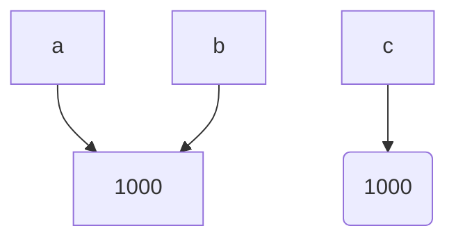

---
tags:
  - Лаба
  - Отчет
---
# Task_1
## 1
При запуске кода через запуск файла питон выполняет вычисление выражение но не выводит его в терминал, потому что нет нужной для этого команды print. В режиме repl питон автоматически выводит любой результат из оперативной памяти в терминал.
Ответ на контрольный вопрос:
>Байткод != машинный код процессора, так как байткод - универсальный набор инструкций для виртуальной машины CPython, которая затем выполняет эти инструкции с помощью команд для процессора, которые могут быть разными в зависимости от типа процессора и его архитектуры.

## 2
- Выражениями являются фрагменты кода (4 * 2) и ()"Python"), а также строка (f"{course}: {hours} часов") так как данные строки возвращают какое то значение и питон может присвоить это значение какой то переменной.
- Инструкциями являются все три строки кода:
  операции присвоения а также команда print()
- В программе присутствуют такие литералы как: ("Python") - строка, (f"{course}: {hours} часов") - f-строка
- При выполнении программы создаются два имени: (course) и (hours). f-строка в данном случае это просто выражение не привязанное к какой - либо переменной.
## 3
1. Python 3.14.7  
2. AST:
	## Общий результат
		
	Module(
   body=[
      Assign(
         targets=[
            Name(id='course', ctx=Store())],
         value=Constant(value='Python')),
      Assign(
         targets=[
            Name(id='hours', ctx=Store())],
         value=BinOp(
            left=Constant(value=4),
            op=Mult(),
            right=Constant(value=2))),
      Expr(
         value=Call(
            func=Name(id='print', ctx=Load()),
            args=[
               JoinedStr(
                  values=[
                     FormattedValue(
                        value=Name(id='course', ctx=Load()),
                        conversion=-1),
                     Constant(value=': '),
                     FormattedValue(
                        value=Name(id='hours', ctx=Load()),
                        conversion=-1),
                     Constant(value=' часов')])]))])```
                     ```
 Узлы AST отвечающие за:
	 -  Присваивание
		 Assign(...)
	- Арифметическую операцию
		  Value = BinOp(...)
	- Вызов print():
		  value = Call(
			  func = Name (id = "print", ctx = Load())
1. Dis:
	Инструкции кода отвечающие за:
	- загрузку константы:
		  LOAD_CONST 0 ('Python')
		  LOAD_CONST 1 (':') 
		  LOAD_CONST 2 (' часов')
		  LOAD_CONST 3 (None)
	- вызов функции:
		  LOAD_NAME 2(print)
		  CALL 1
# Task_2
Прогнозы:
- true
- true
- true
- false
Все прогнозы оказались верными.


``` python
a = 1000

b = a

c = None

d = None

print("Типы:", type(a), type(b), type(c))

print("Идентификаторы:", id(a), id(b), id(c), id(d))

print("a == b:", a == b)

print("a is b:", a is b)

print("a == c:", a == c)

print("c is None:", c is None)
```

скорректированный код

ОБъяснение результата следующего фрагмента кода:
   ```python
   first = "python"
   second = "py" + "thon"

   print(first == second)
   print(first is second)
   ```
   - При запуске файла, язык еще до выполнения программы вычисляет значение переменной second, поскольку выражение справа состоит только из литералов. Если в правой части находился оператор input() то языку пришлось бы создать отдельную ячейку в памяти под объект second. В таком случае результат программы был бы
     ```
     true
     false
     ```

Когда применять == , а когда is:
	Применять == следует, когда мы хотим узнать равны ли *значения* двух объектов
	Применять is следует, когда мы хотим узнать относятся ли два объекта к одной и той же "ячейке" в памяти. Т. е. равны ли их *id*.
Ответы на контрольные вопросы:
> 1. После выполнения операции ```b = a``` python создает новое имя, указывающее на тот же объект в памяти, что и ```a```.
> 2. Функция ```type()``` возвращает тип объекта, а ```id()``` возвращает адрес в памяти на который указывает имя.
> 3. Так как None - уникальный объект в памяти, а числа и строки являются объектами со своими адресами в памяти. ```is```сравнивает адреса объектов в памяти, а ``` == ``` сравнивает значения.  
# Task_3
## Exp_A
Исходный код:
```python
x = 17

y = 5

print(f"operaiton:x + y resutl:{x + y} type:{type(x + y)}")

print(f"operaiton:x - y resutl:{x - y} type:{type(x - y)}")

print(f"operaiton:x * y resutl:{x * y} type:{type(x * y)}")

print(f"operaiton:x / y resutl:{x / y} type:{type(x / y)}")

print(f"operaiton:x // y resutl:{x // y} type:{type(x // y)}")

print(f"operaiton:x % y resutl:{x % y} type:{type(x % y)}")

print(f"operaiton:x ** y resutl:{x ** y} type:{type(x ** y)}")
```
Результат:
```
operaiton:x + y resutl:22 type:<class 'int'>
operaiton:x - y resutl:12 type:<class 'int'>
operaiton:x * y resutl:85 type:<class 'int'>
operaiton:x / y resutl:3.4 type:<class 'float'>
operaiton:x // y resutl:3 type:<class 'int'>
operaiton:x % y resutl:2 type:<class 'int'>
operaiton:x ** y resutl:1419857 type:<class 'int'>
```

Операция / (деление) представляет собой деление с округлением и выводит значение с плавающей точкой.

Операция // (целочисленное деление) представляет собой деление, которая отбрасывает дробную часть и возвращает только целое число. Поэтому она всегда возвращает значение типа *int*.

## Exp_B
В языке Python числа не имеют фиксированной разрядности как, например, в языке C++. Числа в python могут занимать неограниченное число байт, в то время как в других языках числа занимают ограниченное число байт и при переполнении диапазона может произойти ошибка либо язык выдаст фиксированную константу.
## Exp_C
В двоичном представлении числа 0.1, 0.2 и 0.3 являются бесконечными периодическими дробями. Язык округляет их до определенных значений, при этом числа 0.1 + 0.2 и 0.3 отличаются на очень малые значение при таком округлении. Поэтому прямое сравнение выдает результат false. При этом оператор math.isclose проверяет насколько разница между reslut и 0.3 мала, и выдает ответ true, так как разница между этими числами действительно очень маленькое число.

Вывод:
	Сравнивать числа с плавающей точкой, полученные, как результат какого - либо математического выражения, стоит только через оператор math.isclose() в библиотеки math.
## Exp_D
Строчка
```
bool("False")
```
выдает True так как функция bool() от аргумента типа "string" возвращает False, только если строка является пустой. В противном случае bool() всегда будет возвращать True.
Ответы на контрольные вопросы:
> 1. Если один объект не кратен другому, то результат деления будет дробным, поэтому результатом деления будет объект типа ```float```.
> 2. ```int("42")``` преобразовывает символы строки ```"42"``` в числа, а ```int(42.9)``` отсекает дробную часть числа ```42.9```
> 3. Результаты ```false``` эксперимента D:
>    - ```bool(0)```
>    - ```bool("")```
# Task_4
Сообщение об ошибке
```python
TypeError: 'str' object does not support item assignment
```
Причина ошибки:
	У объектов типа string нельзя менять элементы подиндексово
Ответы на контрольные вопросы:
> 1. ```len(symbol)``` является функцией от объекта типа `string` и считает количество символов строки, а аргументом функции ```len(symbol.encode("utf-8"))``` является объект типа ```bytes``` и она возвращает количество байтов.
> 2. `start` обозначает начало среза, `stop` означает конец среза строки, а `step` - шаг этого среза.
> 3. Метод `.upper()` возвращает новую строку, для которой выделяется новое место в памяти, исходная строка не меняется.
# Task_5
1. 

| Имя       | Тип объекта после преобразования |
| --------- | -------------------------------- |
| name      | string                           |
| name_exp  | string                           |
| cnt       | int                              |
| time      | int                              |
| r         | int                              |
| i         | int                              |
| ftime_sec | float                            |
| ftime_min | float                            |
| k         | complex                          |
| sq_abs    | float                            |
| has_runs  | bool                             |
2. Выбранная арифметическая строка:
``` python
ftime_min = float((cnt * time) / 60)
``` 
Литералы:
- ```60```
Имена:
- ```ftime_min```
- ```cnt```
- ```time```
Операторы:
- ```*```
- ```/```
- ```=```
Вызовы функций:
- ```float```
	- исходный текст разбирается на литералы, имена, операторы, ключевые слова и т.д.
	- выполняется синтаксический анализ кода, python определяет какой набор ключевых слов отвечает за какую функцию, определяет написан ли код корректно. Создается AST.
	-  Компилятор переводит AST в байткод для виртуальной машины
	- Виртуальная машина принимает байткод и вызывает команды процессора и выполняет сам код.
4. Оператор ```input()``` всегда принимает на вход текст и возвращает объект типа ```string```, из-за этого многие операции могут выполнятся некорректно и давать неверный результат
Ответ на контрольный вопрос:
> Переменные, зависящие от имен, которым присвоили новые значения, не поменяют своего значения до присваивания. Старые объекты в памяти, на которые ссылались новые имена останутся без имени, указывающего на них и будут висеть "мертвым грузом".

# Вывод
Неожиданные для меня особенности Python:
1. Отсутствие ограничения по количеству памяти для переменных, отсутствие ошибок переполнения памяти, в отличие от языка C++.
2. Другой процесс перехода от кода к машинному коду в сравнении с С++.
3. Удобная работа с f-строками.