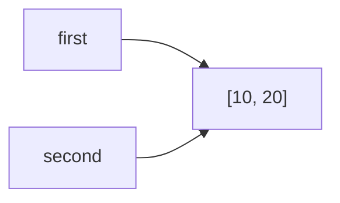
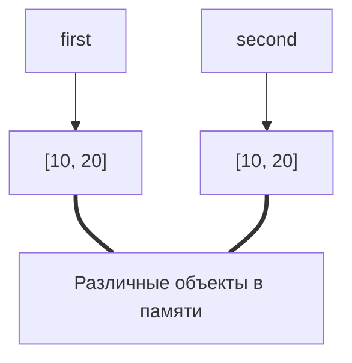

---
tags:
  - Лаба
  - Отчет
  - ОП
---
# Task_1
## Exp_A
**Ожидаемый результат**
>При первой проверке адреса имен `a` и `b` буду совпадать, после изменения значения `a` значение `b` не поменяется, но поменяется адрес `a`.

**Фактический результат**
>Адреса имени `a` действительно поменялось, значение `b` действительно осталось прежним.


Значение `b` не изменилось так как переменная `b` зависела от значения `a`, причем являлась объектом с неизменяемым типом данных `int`, поэтому при изменении `a` *python* создал новый объект в памяти, не удаляя старого, а поскольку имя `b` изначально указывало на один объект с `a`, оно осталось привязано к нему. Причем `b` не поменяет своего значения, пока не произойдет повторного присваивания. 
## Exp_B

Измененный код выглядит так:
```python
first = [10, 20]
second = [10, 20]

print(f"== : {first == second}")
print(f"is : {first is second}")
print(first, second)
print(id(first), id(second))

second.append(30)

print(first, second)
print(id(first), id(second))
```
> Заметим, что в этот раз изменение `second` не повлияло на `first` из - за их изначального объявления.

### Схемы связей между именами и объектами
`До изменений`

`После изменений`

## Вопросы для анализа
> 1. Присваивание `second = first` никак не меняет сам объект в памяти, а лишь добавляет еще одно имя, ссылающееся на данный объект.
> 2. Операция над объектом с неизменяемым типом данных приводит к новому созданию объекта (поскольку данные уже изменить нельзя и приходиться создавать новый объект в памяти), поэтому имя связывается с другим объектом а изначальный либо остается привязан к какому либо имени, либо убирается `мусорщиком` во время выполнения программы.
> 3. Можно сравнить два объекта с помощью `is`, она показывает равны ли `id` объектов на которые указывает имена.
# Task_2

**Ожидаемый результат**
>После первого изменения вывод покажет что: объект `alias` содержит те же идентификаторы, что и у объектов в `original`, объект `shallow` является копией объекта и имеет другой идентификатор в сравнении с `original`, однако содержит те же объекты что и исходный массив, а объект `deep` является полной отдельной копией исходного массива, включая вложенные списки.
>
>При первом изменении исходного массива: вывод данных об `alias` будет аналогичен `original`, а вот в `shallow` и `deep` подмассив не добавится, так как внешние объекты различны.
>
>При втором изменении `original` изменения повторятся и при выводе `alias` и `shallow`, однако объекты массива `deep` останутся без изменений.


**Фактический результат**
> Все ожидаемые результаты подтвердились после запуска алгоритма.

**Таблица учета изменений**

| Операция            | Новый внешний объект | Новые вложенные объекты | Изменения независимы        |
| ------------------- | -------------------- | ----------------------- | --------------------------- |
| Присваивание        | Нет                  | Нет                     | Нет                         |
| Поверхностная копия | Да                   | Нет                     | Только для внешнего объекта |
| Глубокая копия      | Да                   | Да                      | Для любых объектов          |

**Матрицы**
**Ожидаемый результат**
>Присваивание `wrong_matrix[0][0] = 1` заменит все первые элементы вложенных массивов на 1.

**Фактический результат**
>Ожидания подтвердились

C точки зрения памяти, массив `wrong_matrix` содержит внутри себя три ссылки на один и тот же массив `[0, 0, 0]`, поэтому, при изменении его по одной из ссылок, изменения отображаются и во всех остальных вложенных объектах, это происходит из-за неправильного объявления матрицы через умножение, которое просто дублирует ссылку на массив. Массив `correct_matrix` содержит три ссылки на три разных объекта в памяти, поскольку объявляется через цикл создают различные объекты.
## Вопросы для анализа
> 1. Поверхностное копирование создает отдельные объекты только для внешнего объекта, создавая просто дополнительные ссылки на вложенные. Глубокое копирование создает отдельные копии не только внешнего объекта, но и вложенных
> 2. Метод `.deepcopy()` работает рекурсивно и в некоторых случаях может занять большое количество времени и памяти, в некоторых задачах он попросту не нужен (например когда массив состоит из строк или чисел)
> 3. В случаях, если массив состоит из неизменяемых объектов, при проведении операций над которыми, язык сам создаст новый объект.

# Task_3
**Ожидаемый результат**
> После создания `data` счетчик ссылок покажет 1 тк всего 1 ссылка на объект `data`. После создания `alias` - покажет 2 (тк не была создана копия массива а лишь еще одна ссылка на него). После создания `container` - 3 ссылок (так как сам `container` хранит внутри себя только ссылку на массив `data`). После удаления `alias` и очистки `container` счетчик покажет соответственно 2 и 1 ссылки, так как сначала мы удалили имя `alias` (при этом ссылка `data` осталась поэтому сборщик мусора не удалил сам объект) а затем удалили ссылку внутри `container`

**Фактический результат**

> Как оказалось при вызове функции `sys.getrefcount()` также создается временная ссылка на ее аргумент. Поэтому счетчик ссылок будет всегда показывать на 1 больше, чем есть на самом деле без учета функции. Значит итоговые результаты будут 2, 3, 4, 3, 2

- Счетчик ссылок показывает на 1 больше из за временной ссылки на сам аргумент функции, который счетчик тоже учитывает.
- Инструкции присваивания к имени - аргументу, создания массива с ним, удаление ссылок на объект, на который указывает аргумент функции (не только напрямую, но и внутри массива).
- Так как остается еще одна ссылка, указывающая на объект `[1, 2, 3]` сборщик мусора не удаляет данный объект.
  
**Эксперимент со слабыми ссылками**
**Ожидаемый результат**
>После выполнения кода покажет что такого объекта в памяти уже нет.

**Фактический результат**
>Ожидания подтвердились

Слабая ссылка не увеличивает счетчик ссылок, поэтому при удалении `record` на объект `Record()` больше не осталось ссылок и он был удален.
Данные ссылки могут в помочь в ситуации, где два объекта ссылаются друг на друга и сборщику мусора придется дополнительно обрабатывать такие зависимости, что увеличит время работы программы.
### Вопросы для анализа
>1. Если количество ссылок на объект становится 0, то программа автоматически освобождает память.
>2. При удалении объекта *python* просто делает ячейку памяти, в которой лежал объект, свободной, но не возвращает память обратно ОС.
>3. Слабая ссылка не увеличивает счетчик ссылок, указывающих на объект, в отличи от обычных (сильных) ссылок.
# Task_4
**Ожидаемый результат**
> `gc.collect()` будет равно 2.

**Фактический результат**
>Ожидания подтвердились

Подсчет ссылок удаляет объекты, количество ссылок на которые равно 0. Однако в данном примере кода два объекта ссылаются друг на друга и получается замкнутый круг. Даже после удаления имен, объекты все равно будут удалены, так как счетчик ссылок для них все еще будет равен 1. Для этого существует сборщик мусора, которые удаляет такие циклы, а его работа оптимизирована с помощью системы поколений. Чтобы сборщик не проходился слишком часто по всем ссылкам, каждый объект определяется в одно из поколений в зависимости от того как долго он живет в ходе выполнения программы, всего поколений 3 и чем выше поколение, тем реже сборщик мусора "добирается" до их объектов.

**Дополнительный эксперимент**

**Ожидаемый результат**
>Сборщик удалит 6 объектов

**Фактический результат**
>Ожидания подтвердились

### Вопросы для анализа
>1. в
>2. в
>3. Для оптимизации своей работы, чтобы не проходится по каждому объекту в памяти, он делит их на поколения.

# Task_5
## Часть 1.

`sys.getsizeof()` возвращает только размер контейнера, так как в памяти в этом контейнере лежат не сами объекты а только ссылки на них.
## Часть 2.

- Нет, размер массива увеличивается не всегда. *Python* при создании массива резервирует дополнительное место, таким образом при поочередном добавлении переменных в массив они сначала заполняют зарезервированные места, а только потом, на определенном шаге, массиву приходится расширятся.
- Так как расширение массива ищет свободное место в памяти и создает его копию, при частом расширении массива может сильно увеличится время работы программы. Вместо того, чтобы увеличивать размер массива после каждого `append` *python* заранее резервирует дополнительно место, что позволяет оптимизировать работу программы.
- Длинна списка - количество элементов массива. Объем выделенной памяти - сколько байт занимает массив в памяти. При добавлении новых указателей в массив, размер может измениться, а его длинна - нет.

## Часть 3.

**Вывод**
>Создание объекта через `range()` и `list(range())` отличается тем, что в памяти `list(range()` хранится полностью, содержит каждую ссылку на свой элемент, а `range` содержит лишь данные о трех своих аргументах : `start`, `stop` и `step`, занимая таким образом гораздо меньше памяти, чем материализованная последовательность. Также *python* иначе проверяет принадлежность какого то объекта к массиву: для `list` он будет перебирать все элементы массива и сравнивать их с искомым объектом, а для `range()` *python* просто проверит двойное неравенство для границ массива и искомого элемента его и кратность параметру `step`.

## Итоговый анализ
- **Способ 1** [Эксперимент А из задания 1](##Exp_A):
  Присваивание новой ссылки к тому же объекту. Можно использовать, если не нужно создавать два уникальных объекта в памяти, изменения которых буду независимы. 
- **CпосОб 2** [Метод поверхностного копирования из задания 2](#Task_2):
  Создание поверхностной копии объекта, имеющего вложенные в него элементы, чтобы не создавать лишних копий внутренних элементов, если это не требуется, не занимать время работы и занимаемую память алгоритма работой метода `.deepcopy`
- **Способ 3** [Использование слабых ссылок из эксперимента задания 3](#Task_3):
  Чтобы объекты, на которые никто не ссылается не хранились в памяти слишком долго (в случае если один объект ссылается на другой), можно использовать слабые ссылки, которые не увеличивают счетчик ссылок для данного объекта.
## Практическая задача